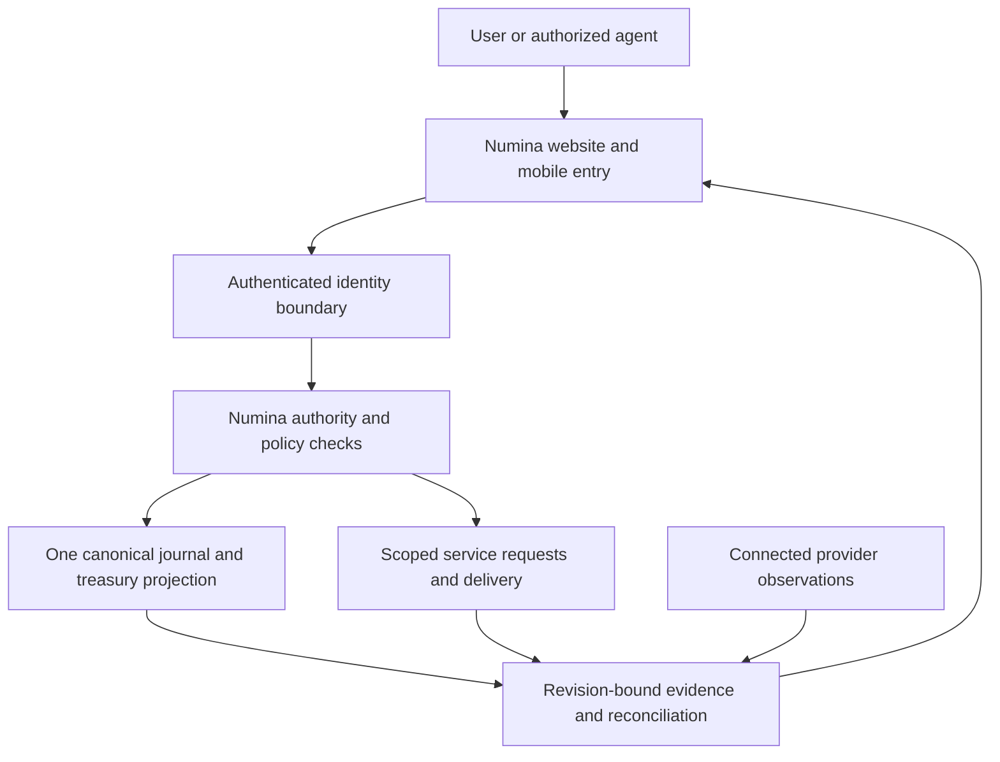

# Numina: singular security and financial control model

**Document date:** September 15, 2026  
**Operator:** SK Consulting LLC, Iowa, USA  
**System:** Numina, package `xyz.numinalabs.app`, hosted application 4.0.0  
**Maintained public copy:** https://numinalabs.xyz/downloads/Numina-Security.md

## 1. Purpose and evidence status

Numina is one connected system: one canonical authority, one Numina-native treasury, one application journal and one security model across its website, mobile wrapper, control interfaces and integrations. Its ambition to support a financial economy requires verifiable software controls, lawful operations and enforceable customer rights together.

This document describes the reviewed implementation, its threats and the operational requirements needed to support that ambition. **Implemented** means a control is visible in source and, where listed, exercised by automated tests. **Observed** refers to a dated service or Console observation. **Required / unverified** identifies evidence still needed. A documented requirement is not proof it has been implemented or independently assessed.

The maintained app source is 4.0.0; the Play candidate remains the previously signed 3.0.0 / code 2 Android bundle. A wrapper signature does not freeze the hosted pages it opens. Hosting updates, native builds and Play publication each have their own evidence.

No independent penetration test, smart-contract audit, reserve audit, SOC 2 examination, ISO certification, regulator authorization or complete OWASP/NIST assessment is established by this document. Historical signed artifacts retain their exact assessment scope.

## 2. One system and its trust boundaries

Connected providers supply services and observations within this architecture. Their records keep their original currency, timestamp, provenance and contractual meaning. A native projection, provider observation, policy decision, customer entitlement and settled transfer have different evidence requirements. Combining them in one interface must preserve those distinctions and must not count the same reserve asset twice.

The [surface inventory](https://numinalabs.xyz/security-surfaces.json) connects the website, app, service API, control API, MCP discovery and operations, A2A, integration kit, Android, iOS, runtime verifier, treasury, provider observations, financial status, telemetry and release evidence to this same model. The control manifest and generated release/source inventories reference it. Entries describe source interfaces and their access boundaries; they are not claims that every provider or native distribution has been connected in production.

Principal boundaries:

- The public browser and model-generated requests are untrusted inputs.
- The hosting dispatcher supplies authenticated identity headers. Deployment must prevent a caller from bypassing the dispatcher or forging those headers.
- The server authorizes each account, owner or delegated-principal operation before accessing private state.
- The canonical journal binds accepted internal operations to revisions and evidence. Provider execution needs its own authenticated, confirmed result.
- Build systems, signing hosts, hosting administrators and provider accounts remain privileged boundaries requiring operational access review.

## 3. Control register

| Control | Reviewed implementation / evidence | Remaining operational requirement |
| --- | --- | --- |
| Account separation | `src/app-http.js` checks request ownership and operator scope; `tests/app.test.mjs` covers cross-account denial and customer-only checkout/actions. | Verify the production identity boundary and working reviewer accounts. |
| Authority | `src/control-http.js` and `src/frontier-http.js` authenticate owners/delegated principals and reject missing authority configuration. Treasury writes use the canonical route. | Review privileged account access, expiry/revocation procedures and production credential custody. |
| Browser write protection | Same-origin checks on cookie-authenticated mutations, JSON/content limits, bounded body-read time. | Exercise the actual proxy/header topology; review all future state-changing routes. |
| Journal consistency | Revision checks, transaction boundaries, hash-linked records and replay validation; treasury tests cover stale heads, replay and rollback on failed writes. | Independent reconciliation, backup restoration and tamper detection outside the application administrator's boundary. |
| Payment reconciliation | Signed Stripe events, expected amount/currency/link/live-mode checks, idempotent handling, refund/dispute accounting in `src/app-http.js`. | Provider account configuration, actual business classification and financial operations review. |
| Client transport | HTTPS origins, refused redirects and bounded responses in the maintained integration boundary; runtime proxy forwards allowlisted reads. | Inventory connected-provider endpoints and verify production transport settings. |
| Browser protections | CSP, HSTS, no sniffing, frame restrictions, and denied camera/microphone/geolocation in `src/worker.js`. | Confirm effective headers on live static and dynamic responses, including provider-managed routes. |
| Android | Registered package retained; source target API 36; source permission allowlist is INTERNET; cleartext and backup disabled. | Inspect merged AAB permissions, Play validation, installed-device behavior and domain association. |
| Private documents | Owner access, file type/signature and size checks, content hashes, no-store responses, sandboxed rendering. Receipts remain `owner_uploaded_unverified`. | Malware-scanning coverage and independent issuer/document verification remain unverified. |
| Data minimization | Telemetry uses route groups, counters, timing/status and random request identifiers, excluding bodies and account/treasury values. Private API data is excluded from the service-worker cache allowlist. | Hosting/provider log retention and downstream data flows require confirmation. |
| Release identity | Source alignment checks, retained signed-build records and candidate hash checks; Windows checkout rules preserve compared bytes. | Exact deployed revision and archive, signing custody and independent verification must be recorded for each release. |

## 4. Security requirements

| Condition | Existing protection | Remaining requirement |
| --- | --- | --- |
| Cross-account access or forged identity | Server-side ownership checks and authenticated dispatcher boundary. | Direct-origin bypass and compromised identity providers require production testing. |
| Stolen owner credentials | Credential-digest checks and explicit owner/delegation decisions. | Host/administrator compromise is outside a client library's protection. Require least privilege, MFA where supported and tested rotation/revocation. |
| Replayed or concurrently changed commands | Idempotency keys, revisions and atomic journal transitions. | Persist operation identifiers across process restarts and reconcile uncertain external outcomes before retrying. |
| False financial confirmation | Provider facts retain scope; native record commits do not create external settlement evidence. | Screenshots, uploads, labels and model statements can still be misleading; independently validate issuer and provider records. |
| Injection or hostile model output | Input schemas, restricted destinations, CSP and server authorization. | Treat documents, tool results and generated text as data. Do not let them supply credentials, broaden authority or automatically execute instructions. |
| Malicious uploaded document | Bounded PDF/image handling and sandboxed responses. | File-type checks do not constitute malware detection or issuer authentication. |
| Dependency or build compromise | Pinned/locked dependencies and exact source/artifact records. | Review dependency advisories, builder permissions and exact provenance; a historical attestation does not cover a new build. |
| Denial of service or unavailable dependencies | Request/body/response limits, rate counters and bounded upstream calls. | Provider limits, capacity, load testing and recovery targets are not established by unit tests. |
| Misstated reserves or token rights | Exact amounts, provider currency preservation and activation gates. | Independent allocation, encumbrance, custody, legal rights and solvency evidence remain required. |

## 5. Data inventory, privacy and deletion

| Data | Purpose and handling |
| --- | --- |
| Account identifier and email | Authentication, account association and access to the user's service records. |
| Request titles, briefs, success criteria, business country and activity notes | Scope review, delivery and engagement administration; accessed by the authenticated account and operator. |
| Payment references, amounts, refund and dispute facts | Reconciliation. Card handling is performed by Stripe; the workspace does not store a full card number. |
| Owner treasury/provider records and uploaded documents | Restricted evidence and reconciliation. Uploaded documents are not automatically authenticated by the issuer. |
| Abuse-prevention counters | Control access uses a day-bucketed hash derived from connecting IP; service-request limits use a hash derived from account ID and request method. These are pseudonymous identifiers, not proof of anonymization. |
| Application diagnostics | Grouped route, method, status, duration, counters and random request ID. Infrastructure providers may maintain additional logs under their own settings. |
| Public app shell | The service worker caches listed public assets; private API/payment responses are outside that allowlist. |

The public [privacy notice](https://numinalabs.xyz/privacy) is the user-facing record. The app exposes [Delete account](https://numinalabs.xyz/privacy#delete-account), available without reinstalling or signing in, using the existing support channel. Request scope includes associated personal data and provider-held data processed for Numina. The operator must verify ownership, explain lawful retention exceptions and communicate the outcome. A successful navigation test does not verify actual deletion fulfillment.

Before declaring Data safety complete, confirm retention periods, provider contracts/logging, deletion handling, data exports, backups and any IP-derived location. Native GPS permission absence does not settle provider location processing. [Google Data safety guidance](https://support.google.com/googleplay/android-developer/answer/10787469) and [account deletion requirements](https://support.google.com/googleplay/android-developer/answer/13327111) inform this review.

## 6. AI and delegated-agent controls

Models propose work within Numina's authorization model. Tool output, retrieved content or an owner-reported capability does not override a server decision or supply missing provider evidence. The integration boundary restricts destinations and parameters; privileged tokens belong on authorized hosts, never in frontend bundles, prompts or documents.

No direct third-party LLM endpoint was found in the inspected hosted-source paths. Connected clients and downstream service providers still require an inventory: recipient, data fields, purpose, retention, training/use restrictions, subprocessors, disclosure, consent and revocation. Server-side transfers to AI providers fall within the [Google Play User Data policy](https://support.google.com/googleplay/android-developer/answer/10144311).

## 7. Financial operation and activation requirements

The owner reports Numina's intended service scope includes lending, loan facilitation, earned wage access, mobile wallets, transfers, crypto holding and exchange. The Play draft records that scope. Reviewed service routes still reject NUSD payment/execution; the current treasury policy has redemption execution disabled, and the published holder-policy page identifies activation as pending. This discrepancy must be resolved with shipped behavior and operating evidence before a final declaration.

One canonical treasury does not remove the following requirements:

| Requirement | Evidence needed before the corresponding financial operation |
| --- | --- |
| Legal operator and permitted markets | Actual legal entity, applicable registrations/licenses or supported exemption, authorized jurisdictions and provider relationships. |
| Loans and earned wages | Lending role, all fees, repayment terms, relevant APR, representative cost and complaint/support process. EWA must be documented on its own actual terms. |
| Crypto custody/exchange | Custody model, asset/network identity, customer rights, fees, withdrawal process and the relevant registration/licensing evidence requested by Play. |
| Customer terms | Effective issuer/holder agreements, acceptance records, eligibility, disclosures, redemption rights and treatment of closure/disputes. |
| Reserves and reconciliation | Independent provider records, ownership/control, availability, allocation, encumbrances, liabilities and double-counting prevention. A self-issued balance is not independent reserve evidence. |
| Identity and financial-crime controls | Documented responsibility, lawful onboarding/screening, monitoring and escalation; provider and operator obligations must be explicit. |
| Contract and execution security | Independent assessment, controlled signing roles, exact deployment inputs, verified chain/address/runtime, pause/recovery procedures, and reconciliation of actual receipts. |
| Operational readiness | Tested incident handling, access review, backup restoration, customer support and objective activation/rollback criteria. |

The new unsigned-deployment tooling preserves reviewed input hashes and explicit roles; it does not sign or broadcast. Local contract tests use a test chain. Internal policy adoption does not itself activate external financial operations. See the existing [redemption policy](https://numinalabs.xyz/redemption) and [Google financial-services requirements](https://support.google.com/googleplay/android-developer/answer/9876821).

## 8. Keys and access administration

Maintain an inventory of credential purpose, custodian, environment, scope, creation/expiry, rotation and revocation evidence. The canonical authority is singular; administrative responsibilities can still be independently reviewed. Provider balances, signing credentials and sensitive documents must not be placed in public downloads or logs.

Keep Android upload and Play app-signing identities distinct. The original candidate's hash is `d25633e4aa9fa75f509cc145506462e49e083ddc3cb8f13872e00e5ea699d550`; the observed Play app-signing fingerprint is `32:0E:E1:C6:E0:7C:2D:82:3E:8E:28:A4:F6:46:0C:73:DF:8A:55:2A:00:42:B6:AA:31:18:57:52:50:54:F4:1C`. Public certificates do not disclose private keys. Actual hardware custody, key-recovery exercises and privileged access reviews remain operational evidence requirements.

## 9. Release and verification procedure

1. Reconcile current source and retain package/root identity. Review changes to authentication, data flows, financial capabilities and dependencies.
2. Build the exact source. Run the applicable tests and retain their outcomes, environment and scope.
3. Check the original AAB bytes and source safeguards with `scripts/check-play-readiness.mjs`; record actual Console validation results separately.
4. Publish the exact committed source and matching build output through the existing hosting service, preserving the site's audience and runtime bindings. Keep the returned deployment result.
5. Verify Play declarations, reviewer access, store assets and upload acceptance before review submission. Record publication and a real Play-installed device test separately.
6. Preserve the last known-good archive and state schema. A rollback must not overwrite newer canonical journal entries or discard evidence.

The September 15 local build and root test suite passed **272 tests**, including the shared security document and surface-inventory binding. The corresponding test output and deployment outcome belong in the dated workstream record; later releases must rerun relevant validation. Browser checks exercised account-deletion navigation and phone layout. They did not establish live authenticated financial workflows, physical-device installation or independent security assurance.

Reference frameworks for a subsequent independent review are [NIST SSDF](https://csrc.nist.gov/projects/ssdf) and [OWASP ASVS](https://github.com/OWASP/ASVS). Listing them is not a conformance claim.

### Connection checks in the application

The `/connections` workspace reads the canonical registry through `/api/connections/v1/manifest`; the public discovery MCP exposes the same inventory with `numina_connections`. Its fixed same-origin checks cover all 19 surfaces with at most four concurrent requests, an eight-second deadline per check, manual redirect handling and a 1 MiB JSON limit. Only the two MCP interfaces receive a fixed initialization request; operational tools and agent messages are never invoked. Each protected endpoint retains its existing authorization.

The page distinguishes available pages, read connections, discovery metadata, package records, access requirements, errors and disabled financial capabilities. Native records do not establish device installation or store publication. Exported observations contain fixed interface paths, status, times and HTTP codes; private payloads, balances, account identifiers and credentials are omitted. Reports are local, unsigned observations. No persistent provider connection or new financial authority is created by a check.

### Dated production connection observation

On September 15, 2026 at 19:30:18–19:30:21 UTC, the version 74 Connections workspace completed all 19 checks in the existing authenticated browser session: **18 responding and 1 needing attention**. Account-service health, the control manifest, both MCP initialization requests, A2A discovery, distribution records, the pinned runtime, authorized treasury/provider reads, telemetry definitions and the release record responded, along with the five page checks. Financial capability status reported disabled operations and correctly remained marked for attention. Private response bodies, balances and account identifiers were not copied into this evidence.

This dated observation does not establish availability for another account or future request, external installation, financial operating authority, reserves, settlement or Play approval. It exercised reads and protocol initialization only. The corresponding Connections release passed 287 automated tests before publication. Source and deployment references are retained in the dated connection record and GitHub issue #25.

### Dedicated production reviewer access

The owner authorized a dedicated Google Play reviewer account and explicitly limited it to its own production records. `/reviewer` provides reusable sign-in without a personal ChatGPT account or one-time code. It is a customer identity, not the canonical owner or an operator. The existing service-order ownership checks control listing, reads, changes and checkout; another customer's records and owner-only treasury views remain inaccessible.

The reviewer password is generated with 256 bits of randomness. Only its SHA-256 digest is configured on the server. A separate random HMAC key signs host-bound eight-hour sessions in a `Secure`, `HttpOnly`, `SameSite=Strict`, `__Host-` cookie. Login accepts at most 2 KiB with a five-second deadline, requires a matching Origin and allows at most 12 attempts per minute per IP-derived bucket. Unknown, expired, duplicate or modified review cookies fail closed instead of falling back to an existing owner session. Login does not create orders, payment facts, owner grants or a second treasury.

Checkout uses the same live Stripe destination and eligibility rules as a normal customer request. Opening checkout does not establish payment; payment status still requires verified provider events. The reviewer credential does not enable NUSD execution or waive financial activation requirements. Server credentials remain on the server; they are not included in reviewer responses or instructions.

The runtime setting `NUMINA_REVIEW_RECORD_SCOPE` must be `own`; broader values are rejected. Set `NUMINA_REVIEW_ENABLED` to `false` to disable access. Rotate `NUMINA_REVIEW_SESSION_KEY` to invalidate existing sessions permanently, and rotate the password digest and update Play Console together when changing the reusable credential. The reviewer account has a stable internal subject so its records retain the same ownership after credential rotation. Credentials must not be committed, published in evidence or copied into issue comments.

Observed September 15, 2026 on production version 76: reviewer sign-in succeeded on the canonical domain; an account-owned request persisted; its live Stripe checkout displayed the diagnostic; the request ended cancelled with zero confirmed payments and refunds. Automated tests verified rejection of other-customer access, owner operations, forged or expired cookies, widened scope and owner-header inheritance. Play Console did not save the entered credentials because its full-access attestation remained unchecked. These observations do not claim store approval, payment completion or access to private owner records.

## 10. Incident response and continuity runbook

This is the operating procedure to exercise and evidence; a completed drill or staffed response SLA is not yet documented.

1. **Receive and classify:** record UTC time, reporter, affected component, observed behavior, affected accounts/assets and confidence. Keep private details out of public issues.
2. **Contain:** an authorized operator suspends the affected capability, revokes compromised access or uses a tested pause control. Preserve the canonical journal and uncertain transactions for reconciliation.
3. **Preserve:** retain original logs, artifact hashes, deployment identities, provider request identifiers and an access-controlled incident timeline. Avoid copying secrets into the incident report.
4. **Assess:** determine access scope, affected personal data and actual financial movement from authoritative records. Assign legal/provider notification decisions to the responsible operator and qualified reviewers.
5. **Recover:** repair the cause, rotate affected credentials, verify clean artifacts and reconcile pending operations before retries. Restore from a tested backup when needed; verify journal continuity and prevent duplicate execution.
6. **Communicate and learn:** report verified impact, remedial steps and unresolved questions to affected parties through appropriate channels. Record root cause, control changes, owners and completion evidence.

The operator must document backup location, encryption/access, retention, restore ownership, recovery-time and recovery-point objectives, and a successful restoration drill. These values are unverified here and are not invented as service guarantees.

## 11. Vulnerability reporting

Contact **skott34@numinalabs.xyz** with subject **Numina security report**. Include the affected URL/component, minimal reproduction, UTC observation time, expected/actual behavior and impact. Arrange a secure channel before sharing sensitive material. Do not send passwords, private keys, full payment data or other users' records in the initial email. This document does not create a bug-bounty payment promise or authorize access to accounts or systems you do not control.

## 12. Evidence register and open decisions

Maintain one change/evidence history for Numina. Every control record should state: requirement, implementation path, environment, source/artifact identity, observation date, reviewer, result, limitation, expiry/recheck trigger and supporting record. Sensitive licenses, provider records and incident evidence remain access-controlled; publish only the appropriate summary.

Current open decisions include: actual financial operating scope and authority; final Play declarations; reviewer access; provider/AI data inventory; retention/deletion fulfillment; independent security assessment; reserve/custody/holder evidence; production header/identity-boundary checks; recovery drills; AAB upload and Play-installed device verification. Track these in the existing Numina rollout workstream. Documenting these items advances the singular system's readiness; only corresponding evidence can close them.

## Financial evidence workspace — September 15, 2026

### NUSD conversion candidates

The [1:1 conversion contract security guide](https://numinalabs.xyz/downloads/NUSD-Conversion-Contracts.md) documents the new same-chain USDC inventory exchange and USD redemption escrow. It covers role separation, explicit holder eligibility, actual output liquidity, precision, atomic rollback, idempotency, reentrancy, claim/refund states and the off-chain bank-confirmation trust boundary. The [software record](https://numinalabs.xyz/api/nusd/v1/conversion-workflow) reports compiled candidates with deployment, reserves and financial activation unverified. No compiler or website deployment creates funds, moves the native treasury, proves a bank outcome or activates a provider write route.

The [financial evidence workspace](https://numinalabs.xyz/financial-services) uses the existing authenticated root and private supporting-document store. Its new register stores immutable, hash-addressed JSON document packets in the existing private object bucket. No customer data, owner credentials, provider metadata or document counts are exposed by its public manifest. Reviewer sessions are explicitly denied access to private financial evidence.

Functions cover document upload, provider/entity/jurisdiction registration, declared expiry and document coverage checks, and private review-packet export. Source references are never fetched. Browser writes require the exact origin; canonical JSON, existing rate limits and bounded body reads apply. File receipts refer to real stored bytes, not invented document identifiers. Identical retries return the original registration. Corrections create another immutable entry.

Coverage is not issuer verification, licensing, a reserve audit, or financial activation. The module does not sign or submit transactions and cannot mark Play ready. Original private documents are downloaded as sandboxed attachments; format signatures are not malware scanning or proof of authenticity. Retention and deletion follow the published operator process, with legal retention decisions recorded separately. See the [operating guide](https://numinalabs.xyz/downloads/Numina-Financial-Services.md) and [draft document worksheets](https://numinalabs.xyz/downloads/Numina-Financial-Document-Templates.md).
